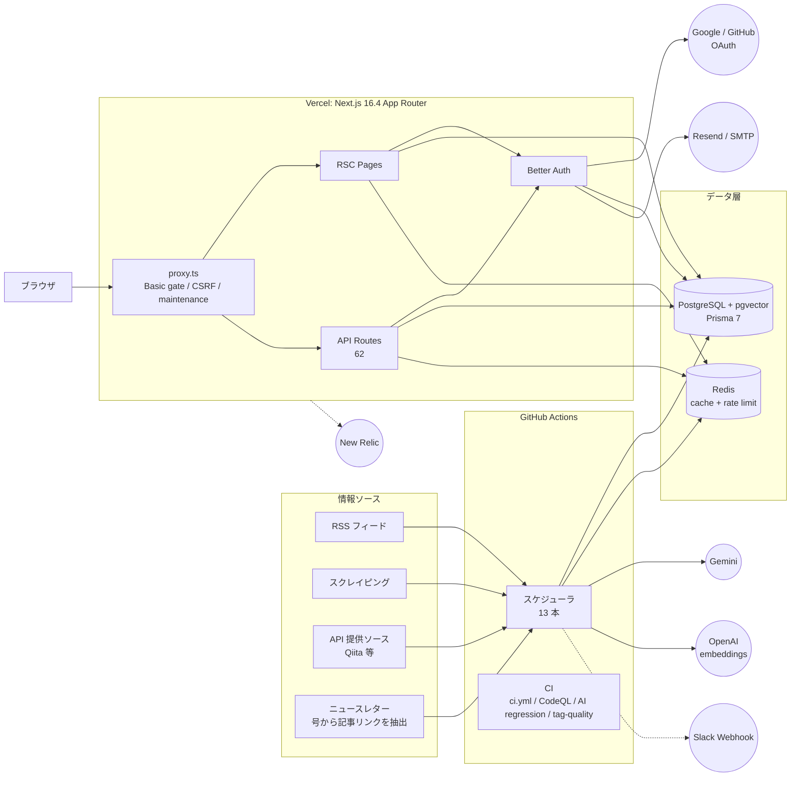
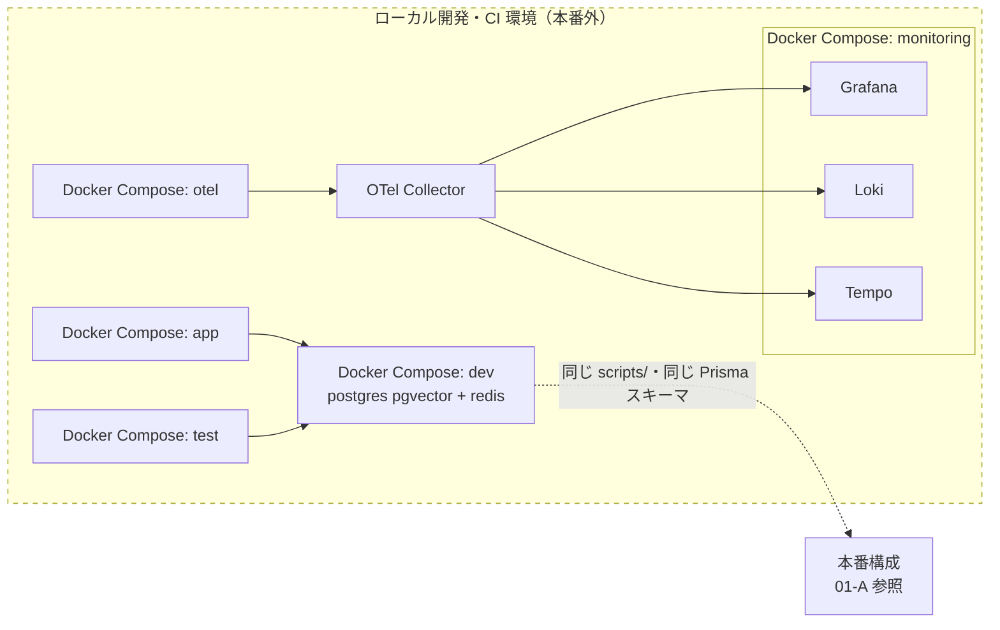

# システム全体構成

TechTrend の本番構成（01-A）と、ローカル開発・CI 専用の構成（01-B）を分けて示す。凡例は [索引](./README.md#凡例全図共通) を参照。

## 01-A 本番構成

情報ソースから記事を収集し、GitHub Actions のスケジューラが要約・埋め込みを生成、Vercel 上の Next.js アプリがユーザーに配信するまでの全体像。

### 読み方

| 図中のボックス | 実体 | 対応する env 変数 |
|----------------|------|-------------------|
| ブラウザ | エンドユーザーのクライアント | - |
| RSS フィード / スクレイピング / API 提供ソース / ニュースレター | `Source` テーブル（2026-10-25 時点の dev DB で 87 件・全件 enabled）+ `lib/fetchers/` 各 fetcher。ニュースレターは `lib/fetchers/curated-newsletter/`。フィード・記事ページの取得は SSRF の検証（`lib/utils/url/safe-redirect.ts`）を通す（API の fetcher の一部は直接取得。[05](./05-features.md#8-記事ソースの取得方式)） | - |
| GitHub Actions スケジューラ 13 本 | `.github/workflows/scheduler-*.yml`（`npx tsx scripts/...` を本番 DB に対して直接実行、失敗時 Slack 通知）。収集・要約の後に Redis のキャッシュも消す | `DATABASE_URL`, `REDIS_URL`, `SLACK_WEBHOOK_URL`, `SLACK_NOTIFICATION_ENABLED`, `GEMINI_API_KEY`, `OPENAI_API_KEY`、vars の `GEMINI_SUMMARY_SERVICE_TIER` など |
| GitHub Actions CI | `ci.yml` / `codeql.yml` / `ai-regression-test.yml` / `tag-quality-check.yml` | - |
| proxy.ts | Next.js middleware（Basic 認証ゲート / NUL バイトの拒否 / CSRF / メンテナンスモード / 保護パスのセッションゲート） | `MAINTENANCE_MODE`, `BASIC_AUTH_ENABLED`/`BASIC_AUTH_USER`/`BASIC_AUTH_PASS`（旧名 `BASIC_PASSWORD`）, `BASIC_AUTH_GATE_SECRET`, `CRON_TOKEN`（旧名 `CRON_SECRET`） |
| RSC Pages | `app/` 配下の公開・認証必須・管理者ページ | - |
| API Routes | `app/api/` 配下 62 件の `route.ts`（一覧は [05 機能一覧](./05-features.md#4-api62本)） | - |
| Better Auth | `lib/auth/auth.ts`（email+password, admin プラグインで RBAC） | `AUTH_SECRET`（フォールバック `NEXTAUTH_SECRET`） |
| PostgreSQL + pgvector | Prisma 7（`prisma/schema.prisma`, 32 model）。マネージド。バージョン・提供元は注記参照 | `DATABASE_URL` |
| Redis | `lib/cache/`（LayeredCache: 用途別キャッシュ）+ `lib/rate-limiter.ts`（`getRedisClient()` 兼用） | `REDIS_URL` |
| Gemini | 要約・抽出（`lib/ai/`） | `GEMINI_API_KEY` |
| OpenAI embeddings | `text-embedding-3-small`（RAG, `lib/rag/`） | `OPENAI_API_KEY` |
| Resend / SMTP | メールアドレスの確認メール（Better Auth、`lib/auth/auth.ts`）。ほかにメールを送る処理は無い | `RESEND_API_KEY`, `SMTP_HOST`/`SMTP_PORT`/`SMTP_USER`/`SMTP_PASSWORD`/`SMTP_SECURE` |
| Slack Webhook | バッチ失敗通知 | `SLACK_WEBHOOK_URL` |
| Google / GitHub OAuth | Better Auth 経由のソーシャルログイン | `GOOGLE_CLIENT_ID`/`GOOGLE_CLIENT_SECRET`, `GITHUB_CLIENT_ID`/`GITHUB_CLIENT_SECRET` |
| New Relic | 本番 APM。Vercel Marketplace 統合で導入する（`README.md:191`「Phase 1.5: 本番環境（Vercel + New Relic）」、手順は `operations/monitoring-setup-phase2a.md`） | アプリ側が読むのは OTLP エクスポータ設定の `OTEL_EXPORTER_OTLP_ENDPOINT` / `OTEL_EXPORTER_OTLP_HEADERS` / `OTEL_SERVICE_NAME`（`instrumentation.ts`）。New Relic 固有の変数はコードから参照していない |

## 01-B ローカル開発・CI 環境

Docker Compose はローカル開発・CI 用の構成。本番と同じ `scripts/` と `prisma/schema.prisma` を使う点が接続点になる。定期実行の定義は GitHub Actions だけにある（PM2 の定義は issue #710 で削除した）。

### 読み方

| 図中のボックス | 実体 | 対応する env 変数 |
|----------------|------|-------------------|
| Docker Compose: dev | `docker-compose.dev.yml`（postgres pgvector/pg17 + redis:7-alpine） | `DATABASE_URL`, `REDIS_URL`（ローカル値） |
| Docker Compose: app / test / monitoring / otel | 同名の docker-compose ファイル群 | - |
| OTel Collector | `docker-compose.otel.yml`。`instrumentation.ts` の OTLP HTTP エクスポート先（ローカル時） | - |
| Grafana / Loki / Tempo | `docker-compose.monitoring.yml`。全ポート `127.0.0.1` バインドでローカル専用 | - |
| 本番構成（01-A 参照） | 同じ `scripts/` ディレクトリと `prisma/schema.prisma` を本番 GitHub Actions が実行 | - |

## 注記

- **本番 PostgreSQL のバージョンと提供元は断定しない**。`pg17` と確認できるのはローカル用の `Dockerfile.postgres-pgvector`（`FROM pgvector/pgvector:pg17`、`docker-compose.dev.yml` が使用）だけで、本番の接続先バージョンはコードから取得していない [推測]。提供元についても、運用手順書 `docs/operations/rag-rollback-procedure.md` では Neon の操作（Snapshot 取得、`console.neon.tech`）を記載しているが、`docs/VERCEL_MIGRATION_SETUP.md` は Prisma Postgres（db.prisma.io）と記述が混在しており、現行の提供元はコードからは確定できない [推測]。GitHub Actions は `secrets.DATABASE_URL` のみを参照しており、接続先そのものはワークフロー定義から特定できない
- **Upstash は使っていない**。レート制限の実体は `lib/rate-limiter.ts` で、`REDIS_URL` の ioredis クライアント（未設定時はメモリ）を使う。したがってキャッシュとレート制限は同じ Redis 1 ノードを共有している（Upstash 用の env の定義は使われていなかったので削除した）
- Source 87 件は 2026-10-25 時点の **dev DB** の値（本番の件数は未確認）。取得コマンド: `docker exec techtrend-postgres psql -U postgres -d techtrend_dev -c 'SELECT COUNT(*), COUNT(*) FILTER (WHERE enabled) FROM "Source";'`
- API routes 62 件の取得コマンド: `find app/api -name route.ts | wc -l`
- GitHub Actions スケジューラ 13 本の取得コマンド: `ls .github/workflows/scheduler-*.yml | wc -l`

---
2026-08-15 時点のコードをもとに作成し、2026-10-25 時点のコードに合わせて更新。更新ルールは [索引](./README.md) を参照。
